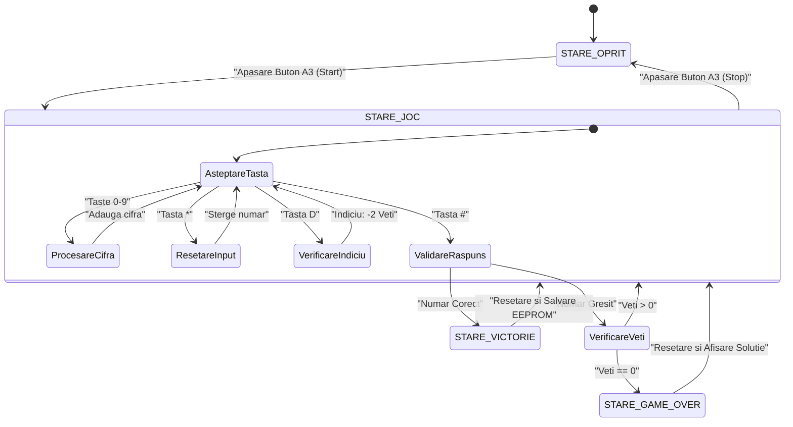

# Joc de Ghicit Numărul (0-100) pe Microcontroler Arduino

Proiect dezvoltat pe arhitectură de Automat de Stări Finite (FSM) folosind o plăcuță Arduino Uno/Mega, ecran LCD 1602, tastatură matriceală 4x4, buton mecanic de Start/Stop, feedback acustic și vizual (LED-uri + Buzzer) și persistență de date în memoria non-volatilă EEPROM.

## 🛠️ Componente Hardware
- **Microcontroler:** Arduino Uno / Mega 2560
- **Afișaj:** LCD 1602 (Mod 4 biți)
- **Introducere date:** Tastatură matriceală 4x4
- **Control alimentare:** Buton push cu filtru software de debounce
- **Feedback vizual:** LED Verde (Victorie), LED Roșu (Eroare)
- **Feedback acustic:** Buzzer activ
- **Memorie:** EEPROM (Salvare Record Timp)

## 📐 Arhitectură Software (Diagramă FSM)

## 🎮 Comenzi Tastatură
- `0 - 9`: Introducerea numărului
- `#`: Enter / Validare răspuns
- `*`: Ștergere cifră
- `D`: Indiciu / Trișare (Afișează numărul secret timp de 2 secunde, cost: 2 vieți)